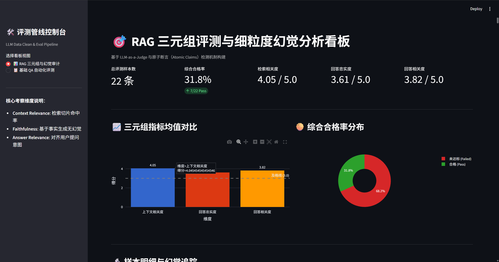

# 基于 Python 的生成式 AI 问答数据清洗与自动化评测管线 (LLM Data Clean & Eval Pipeline)

[](https://github.com/xuetongshuaige13-spec/llm-eval-pipeline/actions)


面向企业级大模型问答系统与智能体应用的轻量化工程管线。涵盖从原始弱格式/脏数据的声明式模式清洗，到基于 **LLM-as-a-Judge 的 RAG 三元组细粒度幻觉排查**与 **Agent 工具调用决策审计**，支持异步高并发流量削峰，并提供交互式 Web 审计看板与全自动 CI/CD 验证。

<p align="center">
  
</p>

---

## 🌟 核心特性

- **数据契约与声明式清洗 (Data Engineering)**:
  - 基于 **Pydantic V2 (Rust-core)** 实现底层高性能流式验证，自动过滤缺失字段与格式残损数据。
  - 自动隔离脏数据并生成标准化清洗审计日志（清洗拦截率、格式异常统计）。
- **RAG 三元组评估与细粒度幻觉定位 (RAG Triad & Hallucination Audit)**:
  - 实现 **Context Relevance（检索相关度）**、**Faithfulness（事实忠实度）** 与 **Answer Relevance（回答相关度）** 三维量化。
  - 落地**原子断言拆解（Atomic Claims Decomposition）**技术，将长回答解构为独立命题逐一做蕴含验证（Entailment Check），精准定位幻觉句子并输出裁判推理链（Rationale）。
- **Agent 工具调用决策与参数审计 (Agent Tool-Use Evaluation)**:
  - 采用确定性断言（Deterministic Assertion）评测 Agent 的 Function Calling 行为。
  - 细粒度计算**参数精确率（Precision）**与**召回率（Recall）**。
  - 设立闲聊负样本测试集，专门审计模型对非工具意图的**防误触发率（Over-triggering Check）**与拒识能力。
- **高并发与网络韧性调度 (High-Concurrency Engine)**:
  - 基于 `asyncio.Semaphore` 实施信号量限流削峰，保护下游 API 不被击穿。
  - 结合 `tenacity` 配置**带随机抖动的指数退避（Exponential Backoff with Jitter）**，应对 HTTP 429 限流与偶发网络抖动。
- **交互式 Web 看板与工程交付 (Dashboard & CI/CD)**:
  - 基于 **Streamlit** 构建多维度评测看板，支持合格率分布、三元组均值雷达图与原子级事实高亮下钻。
  - 配置 **pytest** 单元测试套件与 **GitHub Actions** CI 持续集成流水线，保障多环境自动化交付。

---

## 📁 项目结构

```text
llm-eval-pipeline/
├── .github/workflows/ci.yml   # GitHub Actions CI 自动化构建配置
├── assets/                    # 看板指标与幻觉分析截图
├── data/
│   ├── raw/                   # 原始脏数据与 Benchmark 测试集
│   └── processed/             # 清洗与评测审计输出 (JSONL)
├── scripts/
│   └── generate_benchmark.py  # 评测基准数据集生成脚本
├── src/
│   ├── clean_pipeline.py      # 数据清洗流水线 (Pydantic V2)
│   ├── eval_pipeline.py       # 异步并发评测引擎与 Agent 审计
│   ├── rag_eval_pipeline.py   # RAG 三元组与原子断言幻觉评估器
│   └── app.py                 # Streamlit 交互式评测看板
├── tests/
│   ├── test_clean_pipeline.py # 清洗边界与容错测试
│   └── test_agent_eval.py     # Agent 工具调用审计测试
├── requirements.txt           # 核心依赖清单
└── README.md                  # 工程架构与使用说明
```

---

## 🚀 快速启动

### 1. 环境准备
```bash
git clone [https://github.com/xuetongshuaige13-spec/llm-eval-pipeline.git](https://github.com/xuetongshuaige13-spec/llm-eval-pipeline.git)
cd llm-eval-pipeline
pip install -r requirements.txt
```

### 2. 运行自动化测试 (CI 验证)
```bash
python -m pytest tests/ -v
```

### 3. 生成基准测试数据
```bash
python scripts/generate_benchmark.py
```

### 4. 启动 Web 交互审计看板
```bash
python -m streamlit run src/app.py
```
启动后访问 `http://localhost:8501` 查看 22 条基准样本的多维统计分布与细粒度幻觉排查详情。

---

## 📊 评测基准设计 (Benchmark Coverage)

评测基准集涵盖真实企业落地场景中的 5 类典型分布：
1. **黄金基准样本（Gold Cases）**：检索高命中、无事实幻觉且紧扣用户意图。
2. **事实性幻觉（Hallucinations）**：模型依赖先验知识虚构事实（如费用、地点、软硬件门槛）。
3. **检索噪声污染（Context Noise）**：检索召回无关文档，检验系统的忠实拒答能力。
4. **意图偏离跑题（Answer Drift）**：回答未直接响应用户具体诉求。
5. **Agent 误触发与参数漂移（Agent Tool Errors）**：涵盖工具选型失误、入参噪声及闲聊误调工具。
